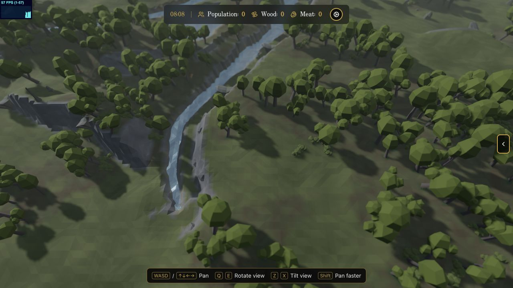
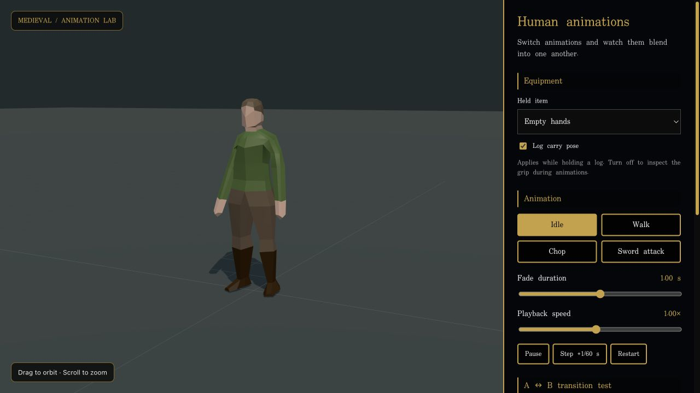
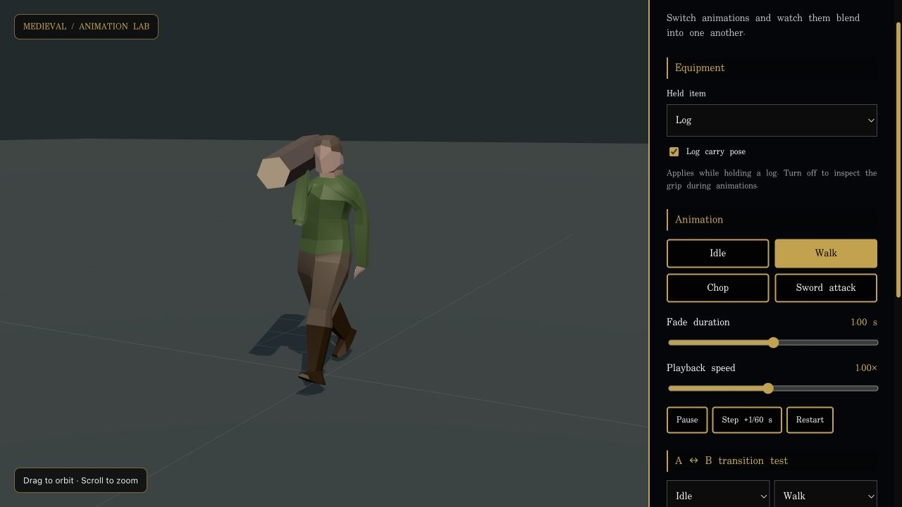
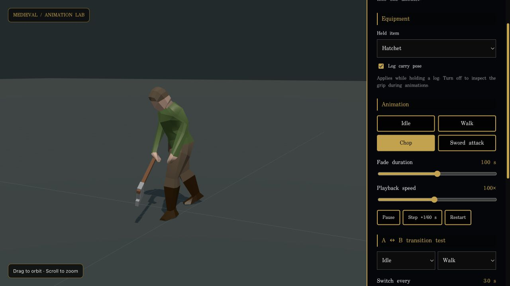
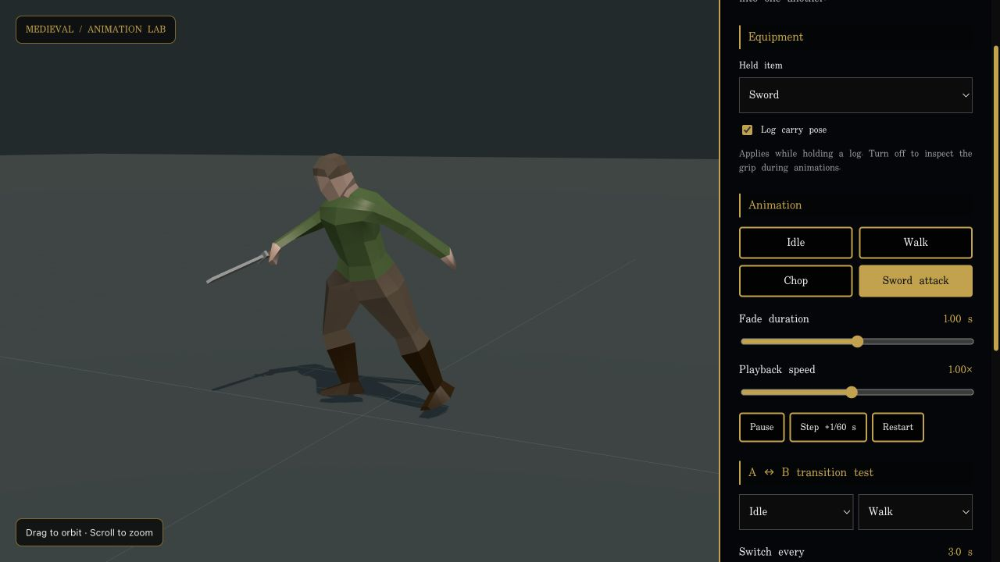
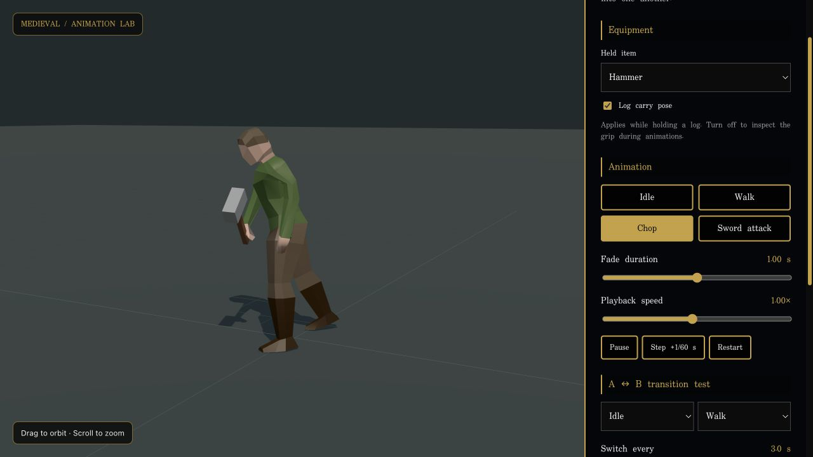

# Medieval

**A browser RTS with a custom TypeScript game engine, a low-poly world, and tools for looking closely at how it all works.**

Build a settlement, put people to work, and watch them carry out their jobs. Woodcutters fell trees and bring logs back to camp. Builders haul timber to construction sites. Hunters track deer, return meat to their huts, and fight back when threatened.

The engine behind those small interactions is part of this repository: the simulation loop, actors, profession state machines, terrain generation, movement rules, construction, saves, and the rendering layer built on Three.js. React handles the interface around the game.

[Play the demo](https://code-cooking-team.github.io/Medieval/) · [Run locally](#run-it-locally) · [Animation lab](#the-animation-lab) · [Explore the engine](#inside-the-engine)


Medieval is an evolving RTS sandbox. The settlement systems, world, and development tools are playable; the project is still being built and refined.

## A world that gives the simulation somewhere to live

Maps are generated from a seed, with forests, mountain regions, cliffs, lakes, and river networks. Drainage and runoff shape the rivers; channel levels and terrain blending produce banks and waterfalls. Replay a world with `?seed=18` when you need to reproduce a terrain or pathfinding problem.



The settlement systems connect to that world:

- **Jobs and resources.** Woodcutters, builders, hunters, and guardians have their own behavior. Workers collect, carry, and deliver resources rather than adding them straight to a global counter.
- **Construction and placement.** Building footprints, rotation, terrain, and obstacles determine where a structure fits. Construction sites wait for materials and builders before becoming finished buildings.
- **Movement and elevation.** Units find routes across the tile grid with height limits and obstacle checks. Raised building surfaces have their own standing heights and connections.
- **Wildlife and combat.** Deer and boars inhabit the map. Humans can hunt, defend themselves, and use weapons attached to their animated hands.
- **Visible state.** Equipment follows the character skeleton, and a wood camp’s log pile changes with its stock level. The scene reflects what the simulation is doing.
- **Save and resume.** Browser saves preserve the world, actors, ownership, and resources.

## The animation lab

A wrist bent the wrong way is easy to miss from an RTS camera. The standalone animation lab brings one character up close, with the same equipment models and shared walk correction and log carry pose used in the game.



Run the dev server and open [the animation lab](http://localhost:3333/Medieval/animation-debug.html). It loads the real human GLTF model without starting the world simulation.

- Switch between **Idle, Walk, Chop, and Sword attack**.
- Equip a **sword, spear, hatchet, hammer, or log**, or leave the hands empty.
- Adjust **fade duration** and **playback speed**. The default fade is one second.
- **Pause, restart, or advance one frame** to inspect a pose or grip.
- Run an **A ↔ B transition test** and watch the live animation weights.
- Orbit and zoom around the character. Toggle the log carry pose to compare the grip with and without the shoulder pose.

The lab lets you combine clips and equipment freely. In gameplay, professions and actions choose the equipment and animation: builders use the chopping motion with a hammer; sword, hatchet, and unarmed attacks share the melee clip. The lab’s fade slider controls its own preview blend; gameplay calculates weights from movement and work.

<table>
  <tr>
    <td width="50%"><br><strong>Walk + log</strong> · Check the shoulder pose while the legs keep moving.</td>
    <td width="50%"><br><strong>Chop + hatchet</strong> · Inspect the swing and hand attachment.</td>
  </tr>
  <tr>
    <td width="50%"><br><strong>Sword attack</strong> · Check the blade angle throughout the motion.</td>
    <td width="50%"><br><strong>Chop + hammer</strong> · The motion used for building in the game.</td>
  </tr>
</table>

Padded armor exists as an equipment item but does not yet have a visual model.

## Inside the engine

Medieval’s game-specific engine is written here in TypeScript. Three.js supplies the graphics primitives and WebGL renderer; EasyStar supplies the path search. The code in this repository connects those pieces into an RTS simulation.

| System | What it owns | Start reading |
| --- | --- | --- |
| Simulation | Tick loop, actor lifecycle, players, events, and snapshots | [Game.ts](src/game/Game.ts) |
| Actors and blueprints | Unit state, building footprints, interactions, and serialization | [core/](src/game/core/), [actors/](src/game/actors/) |
| Profession behavior | Work routines, resource hauling, and state transitions | [professions/](src/game/professions/), [state machines](src/game/core/machine/) |
| World generation | Heightfields, regional terrain, drainage, rivers, and lakes | [world/](src/game/world/) |
| Navigation | Walkability, elevation limits, routes, and raised surfaces | [Pathfinding.ts](src/game/core/Pathfinding.ts), [StandingSurfaces.ts](src/game/core/StandingSurfaces.ts) |
| Rendering | Scene, camera, terrain, water, shadows, and post-processing | [Renderer.ts](src/game/Renderer.ts), [renderer/](src/game/renderer/) |
| Character animation | Locomotion blending, work and combat clips, and equipment attachments | [HumanRenderer.ts](src/game/actors/units/human/HumanRenderer.ts) |
| Input and UI | Selection, orders, placement, HUD, and developer controls | [player/](src/game/player/), [ui/](src/ui/), [App.tsx](src/App.tsx) |

The simulation ticks independently of the render loop, so the renderer can interpolate movement between updates. Buildings use instanced batches and distance-based levels of detail. Actor state, blueprint data, and rendering live in separate layers, allowing the same building or unit to take part in simulation, placement previews, and visual debugging.

For a more detailed route through the code, read the [game code map](docs/game-code-map.md).

## Tools for working on the game

The animation lab sits alongside the in-game development controls:

- **Spawn** places finished actors so you can try a unit or building without waiting for construction.
- **Build** exercises the construction workflow, including material delivery.
- **Stop / Tick** pauses simulation updates or advances them one step at a time.
- **Config** exposes rendering and simulation settings.
- **`window.game` and `window.logStats()`** expose live state and renderer statistics in the browser console.
- **Follow camera** keeps a selected unit in view, useful for inspecting work routines and recording movement.

## Run it locally

Use **Node.js 24 LTS**, the **Bun version pinned in `package.json`**, and a browser with **WebGL 2**.

```bash
bun install --frozen-lockfile
bun run dev
```

Open [the game](http://localhost:3333/Medieval/) or [the animation lab](http://localhost:3333/Medieval/animation-debug.html). Vite uses port `3333` by default and prints another port if it is already occupied. The animation lab is a development entry point; the demo link above opens the game.

### Controls

| Action | Input |
| --- | --- |
| Select units | Left-click or drag a selection box |
| Move, interact, or assign work | Right-click a destination or building |
| Pan the camera | `WASD` or arrow keys |
| Rotate / tilt the camera | `Q` / `E` and `Z` / `X` |
| Pan faster | Hold `Shift` |
| Zoom | Mouse wheel |
| Rotate a building during placement | `R` |
| Cancel placement or exit follow mode | `Esc` |
| Follow a selected unit | `.` |

In follow mode, `A` / `D` orbit around the unit and `W` / `S` change the viewing angle. Touch input supports two-finger panning and pinch zoom.

### Checks and production build

```bash
bun run lint
bun run ts
bun run test
bun run build
bun run preview
```

Tests live beside the code and run with Bun and Happy DOM. For a focused run:

```bash
bun run test src/game/core/Pathfinding.test.ts
```

Use the browser to verify real model loading, WebGL rendering, camera behavior, and animation changes. Unit tests use stand-in model groups. See the [development workflow](docs/development-workflow.md) for save behavior, configuration, and more debugging notes.

## Stack

**TypeScript · Three.js · React 19 · Vite · Tailwind CSS · Radix UI · EasyStar · Bun · Happy DOM · Oxlint**

The simulation and rendering code are under [`src/game/`](src/game/). The React interface is under [`src/ui/`](src/ui/). The standalone animation viewer is under [`src/debug/`](src/debug/), with its entry point at [`animation-debug.html`](animation-debug.html).

## Contributing

Found an awkward animation, an unreachable construction site, or a river that looks wrong? Open an issue with a screenshot and steps to reproduce it. For world-generation bugs, include the seed. For animation bugs, include the clip, held item, and transition settings so the same pose can be checked in the lab.
